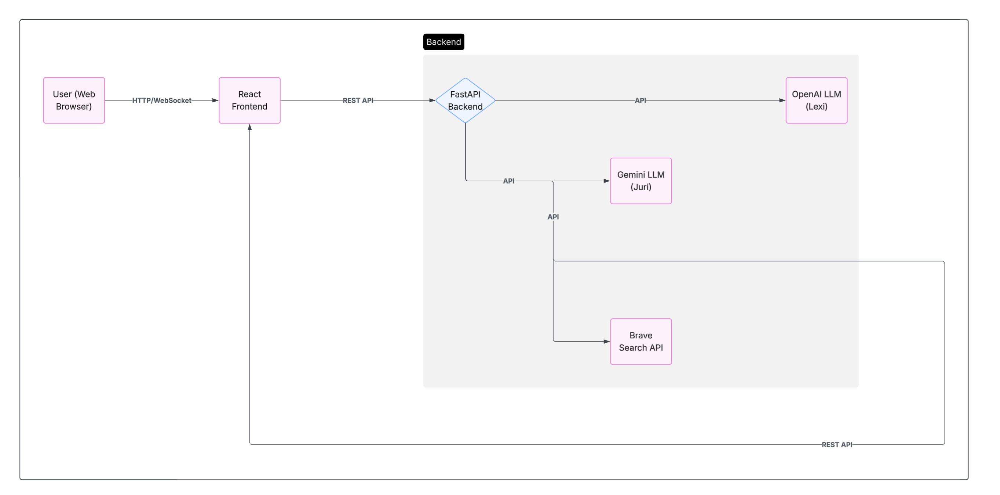

# Nonadvisory Law Bot

A modern, responsible legal information chat app with real citations, emoji feedback, and a beautiful iMessage-inspired UI. **No legal advice is provided**

---

## Overview

Nonadvisory Law Bot is a professional, real-time legal information system. It provides general legal information, resource citations, and feedback features in a modern chat interface. **It never provides legal advice.**

---

## Features

- Modern chat UI (dark mode, animated, iMessage-style)
- Login and landing pages (demo auth)
- FastAPI backend with OpenAI & Gemini (Palm) LLMs
- Resource/citation display with clickable links
- Citation hallucination warnings
- Emoji feedback on bot messages (with backend feedback endpoint)
- Typing indicator, message status, and smart suggestions
- Full API docs, deployment guide, user manual, and compliance docs

---

## Architecture

- **Frontend:** React (chat UI, emoji feedback, resource citations, login/landing pages)
- **Backend:** FastAPI (Python), OpenAI LLM, Brave Search API, Gemini (Palm API)
- **State:** Conversation and feedback stored in memory (not persistent)
- **Modules:**
  - `backend/main.py`: FastAPI app, endpoints, LLM and search logic
  - `backend/palm_api.py`: Gemini (Palm) chat logic

---

## System Architecture

**Explanation:**

- The user interacts with the React frontend via a modern chat UI in their browser.
- The frontend communicates with the FastAPI backend using REST API calls (for chat, feedback, history, etc).
- When a user asks a question, the backend:
  - Queries the Brave Search API for relevant legal resources.
  - Sends the user’s question and search context to OpenAI (Lexi) for a draft answer.
  - Optionally sends the answer to Gemini (Juri) for review and improvement.
  - Returns the final answer, citations, and discussion to the frontend.
- The frontend displays the answer, clickable citations, and allows emoji feedback, which is sent back to the backend for analysis and improvement.
- All state (chat, feedback) is stored in memory for demo purposes (no persistent storage).

---

## Quick Start

### Backend

1. See `DEPLOYMENT.md` for full setup.
2. Install Python deps: `pip install -r backend/requirements.txt`
3. Set up `.env` with your API keys (OpenAI, Brave Search)
4. Run: `uvicorn backend.main:app --reload`

### Frontend

1. `cd frontend && npm install && npm start`
2. App runs at `http://localhost:3000` (proxy to backend)

---

## Usage Guide

1. Go to the landing page and log in (demo login).
2. Enter your legal question in the chat input.
3. View bot answers, resources, and citations.
4. React to bot messages with emojis for feedback.
5. Use smart suggestions for quick questions.
6. Reset chat with the reset button.

- All conversations are stored in memory (not persistent).
- Feedback is used to improve future responses.
- For legal advice, consult a qualified attorney.

---

## Testing & Coverage

- Run all backend tests: `pytest --cov=backend --cov-report=term --cov-report=html`
- See `tests/COVERAGE.md` for details

---

## Documentation

- [API Docs](API_DOCS.md)
- [Compliance](COMPLIANCE.md)

---

## Security, Privacy & Responsible AI

- All user input is sanitized and validated.
- No sensitive data is logged or stored.
- CORS is restricted to trusted origins (configure in FastAPI for production).
- Use HTTPS in production.
- API keys are stored in environment variables, never in code.
- No personal data is stored or shared.
- Conversation history is in-memory only (not persistent).
- Feedback is anonymized and used only for improvement.
- The bot never provides legal advice, only general information.
- All answers include a disclaimer.
- Citations are checked and hallucination warnings are shown in the UI.
- Feedback is used to improve accuracy and reduce hallucinations.
- Users are reminded to consult a qualified attorney for legal advice.
- Not for use in production without further review for GDPR, CCPA, or other regulations if storing user data.
- All LLM outputs are filtered for responsible use and ethical compliance.
- See `DISCLAIMER.md` for legal and ethical usage terms.

---

## License & Disclaimer

See `LICENSE` for details.

**Disclaimer:**
This system is **not a lawyer** and does **not provide legal advice**. The responses generated by Nonadvisory Law Bot are based on publicly available legal information and may be incomplete, outdated, or inaccurate. **This tool is for informational and research purposes only.** Always consult a qualified legal professional for legal advice regarding your specific situation. Use of this system does not establish any attorney-client relationship.
